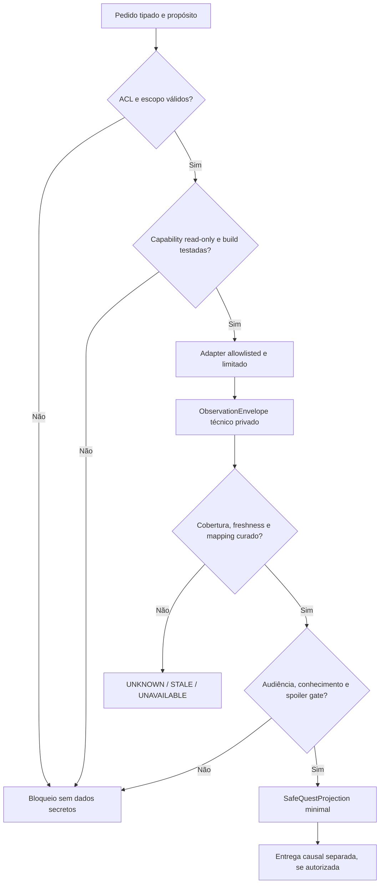

# 100 — Contratos de observação somente-leitura de quests e scripts, privacidade e fronteiras de conhecimento

> **DEC-100/C aprovada em 2026-11-07; Discovery v9.6.** Este documento é desenho de engenharia, **não especificação de interface BG2:EE/EEex validada**. ADR normativo `decisions/ADR-0095-observacao-somente-leitura-allowlisted-de-quests-scripts-e-protecao-contra-spoilers.md`.

## 1. Objetivos, responsabilidades e anti-objetivos

**Objetivo:** disponibilizar ao sistema narrativo **apenas observações semanticamente mínimas e autorizadas** sobre progresso de quests e scripts do jogo/mods, sem criar conhecimento onisciente nem modificar engine state. Separar nitidamente (a) observação técnica bruta no adapter (b) interpretação semântica curada (c) projeção liberada para um público específico (d) eventual evento de recepção e conhecimento do destinatário.

**Anti-objetivos:** engenharia reversa não autorizada em runtime; varredura global de flags; espiar scripts de outros mods sem compatibilidade; inferir spoilers; receber todo arquivo de quest no prompt; usar LLM como classificador de ACL; inventar EEex opcodes/hooks; inferir false a partir de silêncio; transformar observação em recibo de ação.

**Fronteiras:** DEC-050/051/052 definem compatibilidade de quests/mods; DEC-099 ownership de **escrita**; DEC-100 define **leitura e divulgação**; DEC-011/012 define mutação host-first; DEC-028/059 e DEC-083–090 protegem segredos. A decisão seguinte DEC-101 detalhará o mapeamento semântico cross-build e estados compostos — não presumir que esteja aprovado.

## 2. Pipeline obrigatório

Uma interface rotulada `read` não basta: **a POC deve demonstrar que não dispara mutações/side effects**. A função pura Python incluída neste pacote avalia apenas fixtures sintéticas; ela não chama o adapter real.

## 3. Contratos candidatos de dados

| Contrato | Campos essenciais | Invariantes |
|---|---|---|
| `ObservationCapabilityManifest` | `probe_id`, build/EEex/bridge/modpack/ordem, adapter revision, consulta tipada, cobertura, `read_only_poc_evidence`, allowed purposes/audiences, mapping id | Não pode conceder acesso usando wildcards ou autodeclaração do cliente; proof per-probe |
| `ObservationRequest` | request ID, campanha/ramo/sessão, host/checkpoint epoch, solicitante, finalidade, audiência, escopo de quest/área, probe ID, deadline | ACL, freshness, no free-text instructions; host valida escopo |
| `ObservationEnvelope` | id opaco, probe ID, revisão, coverage FULL/PARTIAL/UNKNOWN, reading status, origem, tempo lógico, valor técnico restrito, epoch | Envelope privado: **não é payload de LLM nem knowledge de NPC** |
| `SemanticQuestMapping` | source var/predicado privado, revisão de script/mod, condições por fase, public milestone key, status de curadoria | Não usa guesses de LLM; mapeamento precisa ser inequívoco e auditável |
| `SafeQuestProjection` | marco mínimo, valor validado, coverage, audience/purpose, provenance opaca e TTL | Sem dump de scripts, flags, future branch IDs ou spoilers |
| `ObservationDisclosureLedger` | request ID, destinatário, scope, hash de projeção, status, entrega confirmada separada | Autorização ≠ transmissão ≠ recepção ≠ compreensão |
| `ObservationCacheKey` | campaign, branch, audience, purpose, build, modpack, adapter, host epoch, checkpoint epoch, mapping revision | Cache não compartilha segredos entre áreas, campanhas, clientes ou papéis |

**Estados de saída preflight:** `BLOCKED_NOT_ALLOWLISTED`, `BLOCKED_ACCESS`, `BLOCKED_SPOILER`, `BLOCKED_CAPABILITY`, `BLOCKED_KNOWLEDGE`, `UNKNOWN`, `UNAVAILABLE`, `STALE`, `RELEASE_SEMANTIC_MINIMAL`. Nenhum significa host mutation ou conhecimento efetivamente recebido. Para observação técnica interna sem entitlement narrativo, o produto futuro poderá usar `OBSERVED_TECHNICAL_ONLY`, mas não deve transferi-lo à LLM; esse estado não é implementado no exemplo Python.

## 4. Políticas de sensibilidade e audiências

| Classificação | Exemplo abstrato | Política de divulgação |
|---|---|---|
| `PUBLIC_PROGRESS` | etapa já conhecida legitimamente pelo destinatário | Projetar só marco mínimo, se ACL e canal permitirem |
| `PARTY_PRIVATE` | estágio da quest associado ao grupo | Requer grants e consentimentos do grupo/titulares |
| `QUEST_SECRET` | implicações ocultas do roteiro | Bloquear divulgação narrativa por padrão |
| `FUTURE_BRANCH` | ramo futuro ainda não encontrado | Não expor à LLM nem ao jogador |
| `HIDDEN_IDENTITY` | alias ou identidade verdadeira protegida | Política DEC-076/077/083; sem atalho via flag |
| `ROMANCE_PRIVATE` | estado privado de companion ou PC | Filtrar rigorosamente por titular e finalidade |
| `UNKNOWN` | dado sem classificação curada | Fail-closed, sem inferência |

O host pode precisar ler internamente um marcador técnico para compatibilidade, mas o motor de divulgação continua independente. **Leitura técnica por operação não concede conhecimento aos personagens nem eleva permissões do diretor narrativo.**

## 5. Regras de completude, incerteza e temporalidade

1. `NOT_OBSERVED`, campo ausente, `PARTIAL`, `UNAVAILABLE`, `STALE`, versão desconhecida e erro de probe **não** equivalem a `FALSE`.
2. Um marco negativo exige predicado semântico curado + coverage comprovada sobre seu domínio completo + snapshot atual; scan parcial pode permitir um marco positivo específico, mas não provar negação.
3. `host_epoch`, `checkpoint_epoch`, revisão semântica, build/modpack/adapter e TTL devem permanecer pinados; save/load/restore, quest progression ou ACL revogada invalidam cache.
4. Observar `stage_completed` não autoriza concluir `quest_ended`, `NPC_knows_stage`, `player_was_responsible` ou `canon_diverged`.
5. Epoch/tempo DR da DEC-022 e branch/versionamento DEC-020/060–063 impedem observações de uma campanha de contaminarem outras.
6. Cache revogado interrompe acesso futuro; uma fala de NPC já realizada continua sendo acontecimento histórico, não pode ser apagada por `invalidate`.

## 6. Proveniência, versionamento e semântica

- Guardar proveniência técnica **fora da projeção narrativa**, podendo ser auditada apenas por autoridade apropriada. Um hash de manifesto não implica que a API seja segura; precisa de POC real com efeito invariável.
- Distinguir observação de flags, inferência curada de marco, relato de testemunha e fato canônico. Cada tipo tem autoridade e critérios próprios. LLM não atribui significado de script desconhecido.
- Os marcos devem permanecer estáveis ou mapeados por versionamento explícito do modpack. Nomes idênticos de variável podem significar coisas diferentes em builds distintas.
- Decisão **DEC-101 pendente** para dicionário de marcos semânticos e transições compostas por build, inclusive contradições, publicabilidade e estado `AMBIGUOUS`.

## 7. Controles de segurança e falhas

- Nunca transformar `quest description`, arquivos mod, nomes brutos de flags, logs ou strings externas em instruções para agentes. Resumidores recebem apenas projeção minimal curada.
- Logs técnicos registram motivo, hash, policy revision e IDs opacos; não imprimem conteúdo de script ou flags protegidas. Payloads de erro são constantes e sem interpolação de dados secretos.
- Race e TOCTOU: pré-validar e revalidar autorização/epoch imediatamente antes de consultar. Falhas de handshake ou adapter invalidam leituras e caches.
- Probes devem ter orçamento de tempo/CPU, limites de taxa por área/sessão e instrumentação comprovada; a arquitetura não assume que EEex oferece nenhum probe específico.
- Quarentena de dados malformados, modpack alterado, progresso com duas interpretações conflitantes, POC que mostra side effect ou estado contraditório.
- O resultado do script sintético inclui `host_calls=0`, `engine_mutations=0`, `script_reads=0`, `quest_writes=0`, `disclosures_delivered=0`; etiquetas `SYN-` impedem confundir fixtures com build real.

## 8. Cenários de POC reais ainda pendentes

Fase A: Windows e BG2:EE baseline limpa, fixtures de missão sem spoilers em logs e detecção de transições sem alterar scripts. Fase B: EEex e bridge com hashes pinados; atestação de **zero efeitos colaterais** para cada probe, incluindo diálogos/romance/quest flags. Fase C: modpack conhecido, scripts de terceiros, quest com divergências e branch restore. Fase D: host + dois clientes, controle de audiências, roteamento LAN, save/load, desconexão, política de caching e sigilos por PC. Em todas as fases, confirmar por testes independentes que consulta não modifica estado; no primeiro side effect, **reprovar capability**.

## 9. Exemplos locais

- `examples/chronology/quest_observation_v1.candidate.schema.json`: shape de fixture e contratos ilustrativos, não formato EEex.
- `examples/chronology/quest_observation_v1.synthetic.json`: quatro probes e três pedidos, sem nomes de quests reais.
- `examples/chronology/quest_observer_reference.py`: gate puro, sem I/O, sem engine ou LLM, saída mínima.
- `examples/chronology/test_quest_observer_reference.py`: testes unitários sintéticos, separados dos testes candidatos abaixo.

## 10. Matriz de 124 testes de integração — TODOS NÃO EXECUTADOS

Os itens abaixo são cenários de aceitação para futuras POCs em builds pinadas, não testes realizados. Nenhum demonstra presença de hooks ou sondagens BG2:EE/EEex atualmente disponíveis.

### Allowlist, capacidades e compatibilidade por build

- **T100-001 — NÃO EXECUTADO:** Probe não presente na allowlist é recusado antes de consulta ao motor.
- **T100-002 — NÃO EXECUTADO:** Probe allowlisted não ganha automaticamente autorização para executar scripts.
- **T100-003 — NÃO EXECUTADO:** Globais e flags sem propósito específico não podem ser consultadas em lote.
- **T100-004 — NÃO EXECUTADO:** Identificador de script presente em relatório não cria capacidade de observação.
- **T100-005 — NÃO EXECUTADO:** Capacidade de leitura de um campo não autoriza leitura de outros campos.
- **T100-006 — NÃO EXECUTADO:** Revisão de adaptador divergente invalida o probe.
- **T100-007 — NÃO EXECUTADO:** Mudança da versão de BG2:EE exige novo teste de observação.
- **T100-008 — NÃO EXECUTADO:** Mudança da versão EEex invalida evidência de runtime anterior.
- **T100-009 — NÃO EXECUTADO:** Modpack hash divergente bloqueia observação.
- **T100-010 — NÃO EXECUTADO:** Alteração da ordem dos mods exige recertificação conforme manifesto.
- **T100-011 — NÃO EXECUTADO:** Manifesto catalogado sem prova read-only não concede capability.
- **T100-012 — NÃO EXECUTADO:** Probe nominalmente read-only com efeitos colaterais é reprovado em POC.
- **T100-013 — NÃO EXECUTADO:** Probe com capacidade somente sintética é bloqueado no ambiente de jogo.
- **T100-014 — NÃO EXECUTADO:** Mapa ou área sem cobertura declarada não é inferida por uma flag genérica.
- **T100-015 — NÃO EXECUTADO:** Duas definições de probe conflitantes exigem curadoria e falha fechada.
- **T100-016 — NÃO EXECUTADO:** Upgrade do bridge invalida probe não testado na nova revisão.

### ACL, finalidade, audiência e agência dos jogadores

- **T100-017 — NÃO EXECUTADO:** Propósito não permitido bloqueia a consulta.
- **T100-018 — NÃO EXECUTADO:** Papel de diretor narrativo não autoriza automaticamente qualquer flag.
- **T100-019 — NÃO EXECUTADO:** Destinatário diferente da allowlist não recebe marco semântico.
- **T100-020 — NÃO EXECUTADO:** Ramo de campanha diferente bloqueia leitura.
- **T100-021 — NÃO EXECUTADO:** Campanha diferente bloqueia leitura mesmo com quest ID igual.
- **T100-022 — NÃO EXECUTADO:** Sessão divergente bloqueia uso do resultado.
- **T100-023 — NÃO EXECUTADO:** Host epoch divergente bloqueia leitura e cache.
- **T100-024 — NÃO EXECUTADO:** Checkpoint epoch divergente invalida resultados antigos.
- **T100-025 — NÃO EXECUTADO:** PC ausente não concede consentimento para acesso de outro PC.
- **T100-026 — NÃO EXECUTADO:** Delegação de controle tático não concede acesso a segredos.
- **T100-027 — NÃO EXECUTADO:** NPC sem relação causal com o evento não adquire conhecimento pela leitura técnica.
- **T100-028 — NÃO EXECUTADO:** Revogação de autorização bloqueia futuras liberações.
- **T100-029 — NÃO EXECUTADO:** Permissão de leitura não autoriza publicação do relatório.
- **T100-030 — NÃO EXECUTADO:** Permissão de um jogador não se propaga para outro jogador.
- **T100-031 — NÃO EXECUTADO:** Autoridade de host sobre mecânica não significa audiência narrativa universal.
- **T100-032 — NÃO EXECUTADO:** Cliente forja autorização local: servidor ignora pedido indevido.

### Spoilers e dados sensíveis

- **T100-033 — NÃO EXECUTADO:** Flag que nomeia identidade oculta não aparece em prompt ou relatório.
- **T100-034 — NÃO EXECUTADO:** Variável de traição futura não é exportada à LLM.
- **T100-035 — NÃO EXECUTADO:** Marcador de romance privado é suprimido para audiência não autorizada.
- **T100-036 — NÃO EXECUTADO:** Nome de cutscene futura não aparece em mensagens de erro.
- **T100-037 — NÃO EXECUTADO:** Condição de ramo futuro é mantida fora do resumo de quest.
- **T100-038 — NÃO EXECUTADO:** Texto interno de diálogo não é reproduzido como conhecimento público.
- **T100-039 — NÃO EXECUTADO:** Identidade protegida de fonte não pode ser inferida pelo nome da flag.
- **T100-040 — NÃO EXECUTADO:** ID opaco usado para logs não contém nome secreto ou spoilers.
- **T100-041 — NÃO EXECUTADO:** Cache por audiência não mistura estados privados e públicos.
- **T100-042 — NÃO EXECUTADO:** Log de tracing não inclui valores brutos de flags.
- **T100-043 — NÃO EXECUTADO:** Exportação de dossiê DEC-090 não arrasta metadados secretos.
- **T100-044 — NÃO EXECUTADO:** Data de arquivo/script não revela progresso de quest indevidamente.
- **T100-045 — NÃO EXECUTADO:** Texto de mod contendo instruções maliciosas é tratado como dado.
- **T100-046 — NÃO EXECUTADO:** Erro de probe desconhecido não ecoa script solicitado.
- **T100-047 — NÃO EXECUTADO:** LLM não consulta flags ocultas por inferência de nomes.
- **T100-048 — NÃO EXECUTADO:** Classificação de sensibilidade desconhecida impede exposição.

### Cobertura, semântica e incerteza

- **T100-049 — NÃO EXECUTADO:** Scan parcial negativo resulta UNKNOWN, não quest incompleta.
- **T100-050 — NÃO EXECUTADO:** Scan com cobertura desconhecida resulta UNKNOWN.
- **T100-051 — NÃO EXECUTADO:** Leitura indisponível retorna UNAVAILABLE sem adivinhar estado.
- **T100-052 — NÃO EXECUTADO:** Flag ausente não significa quest não iniciada.
- **T100-053 — NÃO EXECUTADO:** Milestone concluído somente com regra semântica curada e prova positiva.
- **T100-054 — NÃO EXECUTADO:** Milestone não concluído exige cobertura suficiente para o predicado.
- **T100-055 — NÃO EXECUTADO:** Quest com flags contraditórias não gera conclusão falsa.
- **T100-056 — NÃO EXECUTADO:** Estado de quest alterado por mod requer mapeamento de versão adequado.
- **T100-057 — NÃO EXECUTADO:** Dois valores de flag com significado dependente de fase não são confundidos.
- **T100-058 — NÃO EXECUTADO:** Proveniência técnica de scan não equivale a observação por NPC.
- **T100-059 — NÃO EXECUTADO:** Estado de ramo futuro não é tratado como presente.
- **T100-060 — NÃO EXECUTADO:** Flag de etapa de quest pode existir antes de evento narrativo conhecido.
- **T100-061 — NÃO EXECUTADO:** Sem mapping curado, LLM não preenche significado por adivinhação.
- **T100-062 — NÃO EXECUTADO:** Projeção semântica não altera fato canônico por si só.
- **T100-063 — NÃO EXECUTADO:** Projeção de observação não confirma comando despachado pelo Infinity AI.
- **T100-064 — NÃO EXECUTADO:** Estado narrativo divulgado permanece distinto de fato mecânico recém-observado.

### Snapshots, tempo, persistência e cache

- **T100-065 — NÃO EXECUTADO:** Leitura após TTL máximo é descartada como STALE.
- **T100-066 — NÃO EXECUTADO:** Observação com timestamp futuro é descartada.
- **T100-067 — NÃO EXECUTADO:** Restauração de save invalida cache de observação.
- **T100-068 — NÃO EXECUTADO:** Troca de host epoch invalida projeção anterior.
- **T100-069 — NÃO EXECUTADO:** Troca de checkpoint epoch invalida estado observado.
- **T100-070 — NÃO EXECUTADO:** Ramo divergente não compartilha resultados de quest.
- **T100-071 — NÃO EXECUTADO:** Mudança de modpack invalida o cache.
- **T100-072 — NÃO EXECUTADO:** Fim de sessão impede reutilização de contexto anterior.
- **T100-073 — NÃO EXECUTADO:** Revogação de ACL impede novas divulgações de resultado em cache.
- **T100-074 — NÃO EXECUTADO:** Marco narrativo já legitimamente recebido não é apagado retroativamente.
- **T100-075 — NÃO EXECUTADO:** Atualização de revisão semântica exige reprocessar projeção.
- **T100-076 — NÃO EXECUTADO:** Scan parcial posterior não nega leitura positiva anterior sem reconciliação.
- **T100-077 — NÃO EXECUTADO:** Host desconectado impede nova leitura dependente do motor.
- **T100-078 — NÃO EXECUTADO:** Cache não compartilha dados com campanha Original isolada.
- **T100-079 — NÃO EXECUTADO:** Roteamento FROZEN/PARTIAL/REALTIME não antecipa mudança de quest.
- **T100-080 — NÃO EXECUTADO:** Replay de evento duplicado não provoca divulgação repetida.

### Proveniência, rastreabilidade e recibos

- **T100-081 — NÃO EXECUTADO:** Observação registra proveniência de adaptador e epoch sem vazar flags.
- **T100-082 — NÃO EXECUTADO:** Manifesto de capability é vinculado ao checksum da build.
- **T100-083 — NÃO EXECUTADO:** Manifesto sem prova de leitura não é promovido a validado.
- **T100-084 — NÃO EXECUTADO:** Revisão de policy fica associada à decisão de acesso.
- **T100-085 — NÃO EXECUTADO:** Recibo do host de mutação é distinto de observation envelope.
- **T100-086 — NÃO EXECUTADO:** Confirmação visual do cliente não substitui prova do host.
- **T100-087 — NÃO EXECUTADO:** Resultado inconclusivo não gera novo world fact.
- **T100-088 — NÃO EXECUTADO:** Falha de probe não desencadeia execução do Action Gateway.
- **T100-089 — NÃO EXECUTADO:** Observação antiga não serve como precondição de write após restore.
- **T100-090 — NÃO EXECUTADO:** Quests originais e scripts de mods preservam ownership de escrita.
- **T100-091 — NÃO EXECUTADO:** Observação allowlisted não autoriza inspeção de inventários de PC.
- **T100-092 — NÃO EXECUTADO:** Mapeamento de estágio não desliga script original.
- **T100-093 — NÃO EXECUTADO:** Proveniência inconsistente envia caso para reconciliação.
- **T100-094 — NÃO EXECUTADO:** Duas observações com epochs incompatíveis não se combinam.
- **T100-095 — NÃO EXECUTADO:** Resultado de teste sintético não é aceito como evidência de EEex.
- **T100-096 — NÃO EXECUTADO:** Auditoria mantém códigos de motivo sem dados sensíveis.

### LLM, cooperação e segurança de integração

- **T100-097 — NÃO EXECUTADO:** Prompt de diretor só recebe estágio mínimo liberado.
- **T100-098 — NÃO EXECUTADO:** Diretor não recebe dump completo de flags por comodidade.
- **T100-099 — NÃO EXECUTADO:** NPC sem acesso causal não recebe informação de quest.
- **T100-100 — NÃO EXECUTADO:** Jogador A não vê romance privado do jogador B.
- **T100-101 — NÃO EXECUTADO:** Cliente multiplayer não cria observation receipt do host.
- **T100-102 — NÃO EXECUTADO:** Host não confunde dados de um cliente com flag confirmada.
- **T100-103 — NÃO EXECUTADO:** Cross-session prompt cache não vaza scripts de outro ramo.
- **T100-104 — NÃO EXECUTADO:** Roteamento LAN não altera audiencia ou finalidade.
- **T100-105 — NÃO EXECUTADO:** Sem rede local segura os probes protegidos são negados.
- **T100-106 — NÃO EXECUTADO:** Texto de mod com prompt injection não modifica ACL.
- **T100-107 — NÃO EXECUTADO:** LLM indisponível não bloqueia checagem determinística.
- **T100-108 — NÃO EXECUTADO:** Strings de erro do EEex são filtradas antes da LLM.
- **T100-109 — NÃO EXECUTADO:** Informações de fonte protegida não aparecem em analítica de debug.
- **T100-110 — NÃO EXECUTADO:** Observação por probe não gera spawn, quest flag ou NPC movement.
- **T100-111 — NÃO EXECUTADO:** Falha em POC de side effects força capability indisponível.
- **T100-112 — NÃO EXECUTADO:** Delegação limitada não vira controle irrestrito de estado narrativo.

### Critérios de POC, regressão e entrega

- **T100-113 — NÃO EXECUTADO:** POC em build limpa comprova invariância de quest flags antes e depois da leitura.
- **T100-114 — NÃO EXECUTADO:** POC com EEex comprova zero efeitos de execução por probe.
- **T100-115 — NÃO EXECUTADO:** POC com dois clientes demonstra isolamento entre audiências.
- **T100-116 — NÃO EXECUTADO:** POC com modpack real documenta ordem e checksums.
- **T100-117 — NÃO EXECUTADO:** Regressão de romances, banters e diálogos é testada sem spoilers em logs.
- **T100-118 — NÃO EXECUTADO:** Testes save/load demonstram invalidação correta de observações.
- **T100-119 — NÃO EXECUTADO:** Teste de restore e rollback prova ausência de cache cross-epoch.
- **T100-120 — NÃO EXECUTADO:** Comparação host/cliente prova que cliente não inventa etapas.
- **T100-121 — NÃO EXECUTADO:** Benchmark de sondagens limita custo e frequência por propósito.
- **T100-122 — NÃO EXECUTADO:** Build não testada falha fechada sem substituição por LLM.
- **T100-123 — NÃO EXECUTADO:** Instrumentação de testes protege arquivos reais e dados de jogadores.
- **T100-124 — NÃO EXECUTADO:** Matrix de cobertura documenta lacunas sem afirmar APIs desconhecidas.

## 11. Dependências e entregáveis futuros

**Aguardam SPEC/POC:** catálogo real de probes por build, enumeração segura de fases de quests, prova de side-effect-free, política de classificação anti-spoiler, mecanismo de ACL/segregação e interpretação semanticamente testada. Nenhum código neste Discovery acessou BG2:EE, EEex ou NPCs reais; os exemplos são invariantes e critérios de projeto.

**Próxima decisão — DEC-101:** mapeamento semântico confiável de estados brutos para marcos de missão por build e resolução de ambiguidade. A decisão DEC-100/C aprova os limites de **observação e liberação**, não uma ontologia específica já verificada para todas as quests e mods.

## Integração DEC-101/C — Discovery v9.7

**Contrato transversal:** DEC-101 interpretation is read-only, version-pinned and independent of gateway/host execution. A confirmed semantic milestone does not authorize actions or prove a command receipt; mod upgrades, checkpoint restore, revised mapping, epoch mismatch or contradictory states cause fail-closed reconciliation. Referências normativas: ADR-0096, documento técnico 101 e DEC-100 (probes somente-leitura). Mapeamento curado por build/modpack/script e prova de transição são obrigatórios; resultados incertos permanecem sem efeitos. **T101-001..128: candidatos NÃO EXECUTADOS**; nenhuma POC EEex/BG2:EE foi demonstrada.

### Integração DEC-102/C (Discovery v9.8)

DEC-102 consome apenas observações DEC-100 validadas, mantendo flags crus protegidos e sem confundir observação com receipt. Ver `docs/102-reconciliacao-semantica-quests-host-overlay-epochs-provas-e-projecoes.md` e ADR-0097. **Arquitetura somente; POCs pendentes.**

### Integração transversal — DEC-103/C (2026-11-07)

**Integração DEC-103/C (Discovery v9.9; ADR-0098):** observar DEC-100, interpretar DEC-101 e reconciliar DEC-102 não são eventos automaticamente propagáveis. Apenas prova semântica atual e reconciliação `CONSISTENT_WITH_PROOF` ou `APPROVED_AND_COMMITTED_REBASE` habilita pedido de admissão lógica por ruleset pinado; rebase `PROPOSE_*` não permite emissão. Proposta, autorização, receipt host e conhecimento de NPC permanecem entidades separadas. Não reabrir quest, editar flags, alterar scripts nem assumir ownership por narrativa. Dedup por occurrence/lineage, sem duplicação após save/load ou observação repetida. Consultar `docs/103-admissao-e-propagacao-causal-de-marcos-de-quests-reconciliados.md`. **Sem POC no motor.**

### Integração arquitetural DEC-104/C — retificação de consequências (Discovery v10.0)

No domínio de **prova observacional versus causa contestada**, aplicar ADR-0099 e `docs/104-retificacao-causal-consequencias-de-quests-contencao-compensacoes-e-conhecimento.md`: retificações curadas exigem grafo de proveniência por campanha/ramo/epoch; **conter apenas novos despachos elegíveis**, quarentenar `DISPATCHED/UNCERTAIN`, preservar recibos e conhecimentos já registrados, propor revisões CAS e Sagas DEC-095 apenas com autorização. Nenhuma correção por LLM ou exclusão retroativa; efeitos mecânicos requerem Action Gateway/host. **Arquitetura aprovada; integração e 140 casos T104-* NÃO EXECUTADOS.**

### Integração DEC-105/C — Discovery v10.1

**Contrato vinculante:** ADR-0100 / doc. 105. Para observação read-only não divulga spoilers por errata, preservar uma fronteira verificável entre prova committed, conteúdo divulgado, transporte, entrega, percepção, conhecimento e opinião. **Nenhum broadcast global, aceitação obrigatória, vazamento de fonte ou escrita mecânica por LLM**; aplicar ACL por destinatário, canal/tempo DR, campanha/branch/epoch, outbox idempotente e gates próprios quando necessário. A DEC-105 é **arquitetural**, com T105-001..144 candidatos **NÃO EXECUTADOS** no jogo; exemplos em `examples/chronology/correction_diffusion_*` são sintéticos.

### Integração DEC-106/C — Discovery v10.2

**Contrato vinculante:** ADR-0101/doc. 106. Para read-only quests não revela spoilers em retratações, preservar prova de retificação curada, destinatários realmente expostos, crença falível, danos efetivamente comprovados, reputação por contexto e medidas voluntárias de reabilitação; a saída é **PROPOSTA**. Nunca broadcast global, perdão compulsório, apagamento de prejuízo, indenização fictícia, mudança de reputação do host ou concessão de ACL pela LLM. Proteger fontes e PCs, respeitar tempo DR, branch/epoch, CAS, ownership, Action Gateway e recibos para efeitos. **T106-001..148 candidatos NÃO EXECUTADOS no jogo**; código/fixture JSON somente sintéticos.

### Integração DEC-107/C — Direito de resposta e mediação voluntária

**ADR-0102 / doc.107 (Discovery v10.3).** Representar pedido, aviso, entrega, percepção, direito de resposta, consentimento, sessão, minuta, aceite por termo e commit como fases diferentes; checks de tempo DR, branch/epochs e idempotência. Ações DISPATCHED/UNCERTAIN reconciliam sem retry cego. **DEC-060..106 e ADRs anteriores preservados; cenários T107-001..152 candidatos NÃO EXECUTADOS em BG2:EE/EEex.**

### Integração DEC-108/C — Cumprimento de obrigações e monitoramento não coercitivo

Observação de variáveis host read-only não confirma transferência de mercadoria sem receipt específico. Fonte: ADR-0103/doc.108; claims ≠ comprovantes, prazos DR ≠ culpa, status `UNCERTAIN` bloqueia nova ação, sem mutações do host. POCs BG2:EE/EEex e T108-001..160 **não executados**.

### Integração DEC-109/C — Obrigações condicionais multipartes

Observação read-only de quest não autentica pagamento. **Condição comprovada ≠ autorização ≠ execução**: DEC-107/108 são pré-condições; DAG versionado/DR/ACL/receipts/fencing e host gates obrigatórios. Fonte ADR-0104 / doc.109. POCs de BG2:EE/EEex e 168 cenários candidatos **NÃO EXECUTADOS**.
