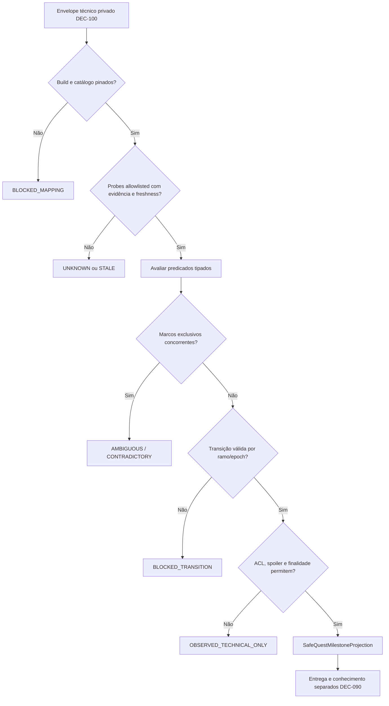

# 101 — Mapeamento semântico curado de quests: catálogos por build, transições, ambiguidade e divulgação

> **DEC-101/C APROVADA em 2026-11-07 — Discovery v9.7.** ADR normativo: `decisions/ADR-0096-mapeamento-semantico-curado-de-estados-de-quests-por-build.md`. Este é um **desenho arquitetural**, não documentação de API real BG2:EE/EEex validada. A DEC-102 está em aberto.

## 1. Escopo e fronteira de autoridade

Esta camada interpreta semântica **apenas de observações DEC-100 que o host comprovadamente permitir**. Fluxo: `(observation envelope técnico)` + `(catalog curado de build)` + `(transição anterior válida)` → `(parecer semântico interno)` → `(ACL/spoiler gate)` → `(projeção mínima de marco para audiência)`. Em hipótese alguma esta camada escreve variáveis, executa Lua, revela scripts, publica spoilers ou assume que um NPC descobriu o acontecimento.

**Preservação:** DEC-050 conciliação de conteúdo; DEC-051 inventário por build; DEC-052 migração; DEC-011/012 ação host-first; DEC-028/059 proteção de contexto; DEC-060–063 cânone por ano; DEC-099 ownership por campo; DEC-100 observação tipada e allowlisted. A DEC-101 **não altera** esses contratos.

## 2. Pipeline de interpretação

O diagrama é conceitual. Falhas e resultados com ambiguidade devem carregar códigos opacos e jamais interpolar nomes/valores secretos nos erros.

## 3. Contratos candidatos

| Tipo | Campos mínimos | Invariantes |
|---|---|---|
| `QuestSemanticCatalog` | `catalog_id`, `quest_key` opaco, `mapping_revision`, build/EEex/bridge/modpack/script/ordem hashes, `review_status`, `curation_evidence`, catalog signature | **Pinning exato**, revisão aprovada e provenance auditável; desconhecido = BLOCKED |
| `SemanticMilestoneRule` | `semantic_id`, `predicate_set` tipado, `required_probe_ids`, `exclusive_group`, `allowed_previous`, `classification`, `negative_proof_policy` | Sintaxe validada; nenhum `eval`, código dinâmico ou LLM interpretando flags |
| `QuestObservationEvidence` | IDs opacos de probes, `read_state`, `coverage`, `observation_epoch`, `observed_tick`, freshness/TTL, `build_hash` | Inputs apenas DEC-100, não disponíveis a NPC/LLM |
| `MilestoneTransitionRecord` | `quest_key`, `from/to`, `branch/epoch`, sequência, `catalog_hash`, evidence refs, `host_event_ref` opcional | Transições confirmadas e persistentes; save/restore troca epoch, não cria progressão fictícia |
| `SemanticInterpretation` | status, `semantic_id` opcional, `rule_revision`, `evidence_digest`, `reason_code` | UNKNOWN/AMBIGUOUS nunca viram verdade por palpite |
| `SafeQuestMilestoneProjection` | `safe_milestone_id`, `audience`, `purpose`, status e provenance opaca | Ausência de raw flag, quest script, future branch, hidden identity e romance privado |
| `SemanticCacheKey` | campaign/branch/audience/purpose, build/EEex/bridge/modpack/script, mapping/observer revisions, host/checkpoint epoch | Sem vazamento entre quests/branches, POCs ou revisões; invalidar em mudança |

## 4. Linguagem declarativa e curadoria

Regras pré-compiladas em JSON Schema validado. Predicados **tipados e finitos** (`eq`, `in`) sobre `probe_id` allowlisted; combinador `all` para a fase piloto. Grupos exclusivos exigem testes de satisfatibilidade para combinações conflitantes e estados que se sobrepõem. Predicados dependentes de relógio DR só são autorizados com fonte temporal e janela curada. Ausência de regra para uma build = `BLOCKED_MAPPING`.

Catálogo técnico e evidência de curadoria são restritos a operadores autorizados e não a diretores narrativos. Mesmo o nome de uma variável pode revelar um segredo futuro; a projeção narrativa usa um ID público diferente, aprovado separadamente.

**Publicação de catálogo:** ingestão de documentação/experimentos → revisão humana → compilação e teste de conflitos → pinning build+modpack+script → hash imutável → ativação por campanha/branch. A mesma variável não é compartilhada entre mods só porque seus identificadores se parecem. Uma alteração de instalação exige recertificação.

## 5. Transições e valores de estado

| Estado | Interpretação |
|---|---|
| `UNKNOWN` | Inexistência de prova suficiente; não equivale à negação da quest |
| `AMBIGUOUS` | Múltiplos marcos plausíveis ou combinação curada insuficiente |
| `CONTRADICTORY` | Observações incompatíveis para o mesmo escopo, sem resolução autorizada |
| `STALE` / `UNAVAILABLE` | Dados vencidos, probe indisponível ou versão divergiu |
| `BLOCKED_MAPPING` | Catálogo desconhecido, revogado ou não pinado |
| `BLOCKED_TRANSITION` | Mudança incompatível com a história confirmada na mesma timeline |
| `OBSERVED_TECHNICAL_ONLY` | Sem permissão de divulgação para a audiência/finalidade |
| `RELEASE_SEMANTIC_MINIMAL` | Marco e escopo mínimos autorizados, **não** entrega ou conhecimento comprovados |

**Restauração:** não tratar redução de `quest_stage` como regressão impossível quando existe novo `checkpoint_epoch` validado; nessa situação, o ramo do save deve ser reconciliado antes de interpretar. Na mesma epoch, regressão contraditória deve ser bloqueada e registrada. Uma etapa que foi completada não permite inferir causalidade, autoria ou fim da quest toda.

**Cobertura:** predicados positivos podem ser satisfeitos mesmo com observação PARTIAL quando os probes requeridos estão comprovados e atuais; negativos requerem prova **exaustiva** explicitamente configurada, nunca `not seen`. Erros `UNKNOWN` e `UNAVAILABLE` não são false.

## 6. Proteção de spoilers, ACL e propagação

O lado técnico guarda observações, fonte e hashes em zona de auditoria privada. A saída narrativa contém apenas `safe_milestone_id` permitido. `QUEST_SECRET`, `FUTURE_BRANCH`, `HIDDEN_IDENTITY`, `ROMANCE_PRIVATE` e informações não classificadas ficam bloqueadas por padrão, inclusive por metadados, logs, cache e nome de rule. O prompt da LLM recebe apenas projeções permitidas; não tem acesso a catálogo e raw observation.

A DEC-029 rege difusão de notícias pelo tempo/local. DEC-083/085 rege segredos e proteção de fontes. DEC-090 rege a entrega documental. Uma projeção disponível não autoriza narrador a contar ao PC algo nunca testemunhado e não equivale a conhecimento de companheiro NPC. Revogar publicação futura não elimina a memória legítima que um personagem já adquiriu.

## 7. Segurança, idempotência e casos de falha

- `READ_ONLY` é POC real por probe e build; schema/Python de exemplo não prova nada sobre o motor.
- Fluxo é somente `READ->VALIDATE->MAP->AUTHORIZE->PROJECT`, sem `Action Gateway.dispatch`, sem update de estado de quest e sem execução de scripts.
- `source_key`, hashes e observações opacas ficam fora de strings de diagnóstico. Erros não incluem valores protegidos, inclusive em exception stack e logging.
- Mudança de mapping, patch de jogo, modpack, ordem, save/load, ACL, host/checkpoint epoch invalida cache.
- Conflito não é resolvido por ordem de regras, contagem de fontes ou criatividade do modelo; bloqueio e abertura de ticket de curadoria.
- Receipts do host DEC-011/012 são independentes de `SemanticInterpretation`; avanço de quest observado é prova de estado, não prova de ação própria.
- `UNKNOWN/AMBIGUOUS` jamais disparam consequência histórica DEC-096/097, spawn DEC-098 ou alteração de ownership DEC-099.

## 8. Exemplo sintético inteiramente fictício

A fixture separa a solicitação de acesso dos registros simulados confiáveis de `policy` e `history` (a própria requisição **não** concede permissões nem atesta transições). Fixture `SYN-QST-01` (não existente no BG2): `SYN-PROBE-STAGE=4` e `SYN-PROBE-DIALOGUE=1` podem satisfazer `SYN-QUEST-OBJECTIVE-DONE` **somente** no catálogo pinado `SYN-BUILD-1`, `SYN-MODPACK-1`, `SYN-CAT-1`. Um `stage=4` isolado não autoriza o marco; um mod hipotético atualizado com significado diferente invalida o catálogo.

Duas regras simultaneamente verdadeiras no mesmo grupo exclusivo produzem `AMBIGUOUS`; uma observação parcial suficiente para a conjunção positiva pode produzir interpretação interna, mas nunca faz prova de negação. `SYN-` identifica exclusivamente dados de teste. Nenhum exemplo contém flags, textos ou finais reais.

## 9. Exemplos e execução de testes

- `examples/chronology/quest_semantics_v1.candidate.schema.json` — contrato JSON Schema ilustrativo.
- `examples/chronology/quest_semantics_v1.synthetic.json` — catálogo e observações 100% fictícios.
- `examples/chronology/quest_semantic_mapper_reference.py` — função Python pura, com `host_calls=0`, `quest_writes=0`, `llm_calls=0`.
- `examples/chronology/test_quest_semantic_mapper_reference.py` — unit tests apenas sintéticos.

Os testes unitários do mapper não substituem os cenários T101 ou certificações com Windows BG2:EE/EEex, bridge, modpack real, save/load e dois clientes.

## 10. Matriz de 128 testes de integração — TODOS NÃO EXECUTADOS

**Nenhum teste a seguir foi executado no motor; todos são candidatos para futuras POCs.**

| ID | Eixo | Cenário futuro | Resultado esperado |
|---|---|---|---|
| T101-001 | Catálogo e pinning | Quest de script conhecido | Produzir apenas interpretação mínima conforme catálogo, evidência, ACL e epoch; sem escrita; **NÃO EXECUTADO** |
| T101-002 | Catálogo e pinning | Quest de mod terceiro | Produzir apenas interpretação mínima conforme catálogo, evidência, ACL e epoch; sem escrita; **NÃO EXECUTADO** |
| T101-003 | Catálogo e pinning | Patch de jogo | Produzir apenas interpretação mínima conforme catálogo, evidência, ACL e epoch; sem escrita; **NÃO EXECUTADO** |
| T101-004 | Catálogo e pinning | Ordem de instalação alterada | Produzir apenas interpretação mínima conforme catálogo, evidência, ACL e epoch; sem escrita; **NÃO EXECUTADO** |
| T101-005 | Catálogo e pinning | Hash de modpack diferente | Bloquear ou manter indeterminado sem divulgação indevida; não mutar host; **NÃO EXECUTADO** |
| T101-006 | Catálogo e pinning | Versão EEex diferente | Bloquear ou manter indeterminado sem divulgação indevida; não mutar host; **NÃO EXECUTADO** |
| T101-007 | Catálogo e pinning | Bridge revision divergente | Bloquear ou manter indeterminado sem divulgação indevida; não mutar host; **NÃO EXECUTADO** |
| T101-008 | Catálogo e pinning | Script digest alterado | Produzir apenas interpretação mínima conforme catálogo, evidência, ACL e epoch; sem escrita; **NÃO EXECUTADO** |
| T101-009 | Catálogo e pinning | Mapeamento revogado | Bloquear ou manter indeterminado sem divulgação indevida; não mutar host; **NÃO EXECUTADO** |
| T101-010 | Catálogo e pinning | Mapeamento em curadoria | Produzir apenas interpretação mínima conforme catálogo, evidência, ACL e epoch; sem escrita; **NÃO EXECUTADO** |
| T101-011 | Catálogo e pinning | Revisão posterior não compatível | Produzir apenas interpretação mínima conforme catálogo, evidência, ACL e epoch; sem escrita; **NÃO EXECUTADO** |
| T101-012 | Catálogo e pinning | Manifest observation divergente | Bloquear ou manter indeterminado sem divulgação indevida; não mutar host; **NÃO EXECUTADO** |
| T101-013 | Catálogo e pinning | Source de curadoria ausente | Bloquear ou manter indeterminado sem divulgação indevida; não mutar host; **NÃO EXECUTADO** |
| T101-014 | Catálogo e pinning | Dois catálogos concorrentes | Produzir apenas interpretação mínima conforme catálogo, evidência, ACL e epoch; sem escrita; **NÃO EXECUTADO** |
| T101-015 | Catálogo e pinning | Assinatura de catálogo inválida | Bloquear ou manter indeterminado sem divulgação indevida; não mutar host; **NÃO EXECUTADO** |
| T101-016 | Catálogo e pinning | Quest_key opaco desconhecido | Bloquear ou manter indeterminado sem divulgação indevida; não mutar host; **NÃO EXECUTADO** |
| T101-017 | Predicados | Conjunção de duas flags | Produzir apenas interpretação mínima conforme catálogo, evidência, ACL e epoch; sem escrita; **NÃO EXECUTADO** |
| T101-018 | Predicados | Disjunção curada de alternativas | Produzir apenas interpretação mínima conforme catálogo, evidência, ACL e epoch; sem escrita; **NÃO EXECUTADO** |
| T101-019 | Predicados | Operador eq com tipo divergente | Bloquear ou manter indeterminado sem divulgação indevida; não mutar host; **NÃO EXECUTADO** |
| T101-020 | Predicados | Operador in com conjunto vazio | Produzir apenas interpretação mínima conforme catálogo, evidência, ACL e epoch; sem escrita; **NÃO EXECUTADO** |
| T101-021 | Predicados | Probe ausente na allowlist | Bloquear ou manter indeterminado sem divulgação indevida; não mutar host; **NÃO EXECUTADO** |
| T101-022 | Predicados | Predicado duplicado | Produzir apenas interpretação mínima conforme catálogo, evidência, ACL e epoch; sem escrita; **NÃO EXECUTADO** |
| T101-023 | Predicados | Valor vazio | Produzir apenas interpretação mínima conforme catálogo, evidência, ACL e epoch; sem escrita; **NÃO EXECUTADO** |
| T101-024 | Predicados | Enum desconhecido | Bloquear ou manter indeterminado sem divulgação indevida; não mutar host; **NÃO EXECUTADO** |
| T101-025 | Predicados | Regra inconsistente | Bloquear ou manter indeterminado sem divulgação indevida; não mutar host; **NÃO EXECUTADO** |
| T101-026 | Predicados | Expressão executável rejeitada | Bloquear ou manter indeterminado sem divulgação indevida; não mutar host; **NÃO EXECUTADO** |
| T101-027 | Predicados | Dependência circular | Produzir apenas interpretação mínima conforme catálogo, evidência, ACL e epoch; sem escrita; **NÃO EXECUTADO** |
| T101-028 | Predicados | Campo com valor falsy | Produzir apenas interpretação mínima conforme catálogo, evidência, ACL e epoch; sem escrita; **NÃO EXECUTADO** |
| T101-029 | Predicados | Dado malformado | Produzir apenas interpretação mínima conforme catálogo, evidência, ACL e epoch; sem escrita; **NÃO EXECUTADO** |
| T101-030 | Predicados | Regex livre proibido | Produzir apenas interpretação mínima conforme catálogo, evidência, ACL e epoch; sem escrita; **NÃO EXECUTADO** |
| T101-031 | Predicados | Cálculo de tempo sem calendário | Bloquear ou manter indeterminado sem divulgação indevida; não mutar host; **NÃO EXECUTADO** |
| T101-032 | Predicados | Variante de quest indisponível | Produzir apenas interpretação mínima conforme catálogo, evidência, ACL e epoch; sem escrita; **NÃO EXECUTADO** |
| T101-033 | Incerteza e cobertura | Probe positivo em cobertura parcial suficiente | Produzir apenas interpretação mínima conforme catálogo, evidência, ACL e epoch; sem escrita; **NÃO EXECUTADO** |
| T101-034 | Incerteza e cobertura | Campo negativo em cobertura parcial | Produzir apenas interpretação mínima conforme catálogo, evidência, ACL e epoch; sem escrita; **NÃO EXECUTADO** |
| T101-035 | Incerteza e cobertura | Ausência de observação | Bloquear ou manter indeterminado sem divulgação indevida; não mutar host; **NÃO EXECUTADO** |
| T101-036 | Incerteza e cobertura | Probe indisponível | Produzir apenas interpretação mínima conforme catálogo, evidência, ACL e epoch; sem escrita; **NÃO EXECUTADO** |
| T101-037 | Incerteza e cobertura | Probe vencido | Produzir apenas interpretação mínima conforme catálogo, evidência, ACL e epoch; sem escrita; **NÃO EXECUTADO** |
| T101-038 | Incerteza e cobertura | Latência acima de TTL | Produzir apenas interpretação mínima conforme catálogo, evidência, ACL e epoch; sem escrita; **NÃO EXECUTADO** |
| T101-039 | Incerteza e cobertura | Valor desconhecido | Bloquear ou manter indeterminado sem divulgação indevida; não mutar host; **NÃO EXECUTADO** |
| T101-040 | Incerteza e cobertura | Resposta parcial com prova incompleta | Bloquear ou manter indeterminado sem divulgação indevida; não mutar host; **NÃO EXECUTADO** |
| T101-041 | Incerteza e cobertura | Prova negativa exaustiva | Bloquear ou manter indeterminado sem divulgação indevida; não mutar host; **NÃO EXECUTADO** |
| T101-042 | Incerteza e cobertura | Duas leituras discordantes | Produzir apenas interpretação mínima conforme catálogo, evidência, ACL e epoch; sem escrita; **NÃO EXECUTADO** |
| T101-043 | Incerteza e cobertura | Duplicata de observação | Produzir apenas interpretação mínima conforme catálogo, evidência, ACL e epoch; sem escrita; **NÃO EXECUTADO** |
| T101-044 | Incerteza e cobertura | Scan de outra área | Produzir apenas interpretação mínima conforme catálogo, evidência, ACL e epoch; sem escrita; **NÃO EXECUTADO** |
| T101-045 | Incerteza e cobertura | Falta de host epoch | Produzir apenas interpretação mínima conforme catálogo, evidência, ACL e epoch; sem escrita; **NÃO EXECUTADO** |
| T101-046 | Incerteza e cobertura | Resposta recebida após restore | Produzir apenas interpretação mínima conforme catálogo, evidência, ACL e epoch; sem escrita; **NÃO EXECUTADO** |
| T101-047 | Incerteza e cobertura | Captura de checkpoint antigo | Produzir apenas interpretação mínima conforme catálogo, evidência, ACL e epoch; sem escrita; **NÃO EXECUTADO** |
| T101-048 | Incerteza e cobertura | Schema backward incompatible | Produzir apenas interpretação mínima conforme catálogo, evidência, ACL e epoch; sem escrita; **NÃO EXECUTADO** |
| T101-049 | Exclusividade e transições | Duas regras exclusivas simultâneas | Bloquear ou manter indeterminado sem divulgação indevida; não mutar host; **NÃO EXECUTADO** |
| T101-050 | Exclusividade e transições | Marco completo com condição adicional | Produzir apenas interpretação mínima conforme catálogo, evidência, ACL e epoch; sem escrita; **NÃO EXECUTADO** |
| T101-051 | Exclusividade e transições | Regressão na mesma epoch | Bloquear ou manter indeterminado sem divulgação indevida; não mutar host; **NÃO EXECUTADO** |
| T101-052 | Exclusividade e transições | Progresso após checkpoint restore | Produzir apenas interpretação mínima conforme catálogo, evidência, ACL e epoch; sem escrita; **NÃO EXECUTADO** |
| T101-053 | Exclusividade e transições | Transição autorizada sequencial | Produzir apenas interpretação mínima conforme catálogo, evidência, ACL e epoch; sem escrita; **NÃO EXECUTADO** |
| T101-054 | Exclusividade e transições | Transição pulando etapa proibida | Produzir apenas interpretação mínima conforme catálogo, evidência, ACL e epoch; sem escrita; **NÃO EXECUTADO** |
| T101-055 | Exclusividade e transições | Quest falhada e resolvida simultâneas | Produzir apenas interpretação mínima conforme catálogo, evidência, ACL e epoch; sem escrita; **NÃO EXECUTADO** |
| T101-056 | Exclusividade e transições | Quest não iniciada e objetivo cumprido | Produzir apenas interpretação mínima conforme catálogo, evidência, ACL e epoch; sem escrita; **NÃO EXECUTADO** |
| T101-057 | Exclusividade e transições | Ramificação alternativa não divulgada | Produzir apenas interpretação mínima conforme catálogo, evidência, ACL e epoch; sem escrita; **NÃO EXECUTADO** |
| T101-058 | Exclusividade e transições | Repetição idempotente de marco | Produzir apenas interpretação mínima conforme catálogo, evidência, ACL e epoch; sem escrita; **NÃO EXECUTADO** |
| T101-059 | Exclusividade e transições | Marco terminal e reset legítimo | Produzir apenas interpretação mínima conforme catálogo, evidência, ACL e epoch; sem escrita; **NÃO EXECUTADO** |
| T101-060 | Exclusividade e transições | Marco original após modificação de quest | Produzir apenas interpretação mínima conforme catálogo, evidência, ACL e epoch; sem escrita; **NÃO EXECUTADO** |
| T101-061 | Exclusividade e transições | Sequência monotônica perdida | Produzir apenas interpretação mínima conforme catálogo, evidência, ACL e epoch; sem escrita; **NÃO EXECUTADO** |
| T101-062 | Exclusividade e transições | Estado futuro anterior ao relógio DR | Bloquear ou manter indeterminado sem divulgação indevida; não mutar host; **NÃO EXECUTADO** |
| T101-063 | Exclusividade e transições | Status contraditório em dois clientes | Produzir apenas interpretação mínima conforme catálogo, evidência, ACL e epoch; sem escrita; **NÃO EXECUTADO** |
| T101-064 | Exclusividade e transições | Prova de conclusão sem prova de autoria | Bloquear ou manter indeterminado sem divulgação indevida; não mutar host; **NÃO EXECUTADO** |
| T101-065 | Privacidade e spoilers | Mapeamento contém nome oculto | Produzir apenas interpretação mínima conforme catálogo, evidência, ACL e epoch; sem escrita; **NÃO EXECUTADO** |
| T101-066 | Privacidade e spoilers | Flag sinaliza romance | Produzir apenas interpretação mínima conforme catálogo, evidência, ACL e epoch; sem escrita; **NÃO EXECUTADO** |
| T101-067 | Privacidade e spoilers | Marco futuro bloqueado | Bloquear ou manter indeterminado sem divulgação indevida; não mutar host; **NÃO EXECUTADO** |
| T101-068 | Privacidade e spoilers | Quest secreta sem grant | Bloquear ou manter indeterminado sem divulgação indevida; não mutar host; **NÃO EXECUTADO** |
| T101-069 | Privacidade e spoilers | Audiência insuficiente | Produzir apenas interpretação mínima conforme catálogo, evidência, ACL e epoch; sem escrita; **NÃO EXECUTADO** |
| T101-070 | Privacidade e spoilers | Propósito diferente | Bloquear ou manter indeterminado sem divulgação indevida; não mutar host; **NÃO EXECUTADO** |
| T101-071 | Privacidade e spoilers | Revogação de acesso | Produzir apenas interpretação mínima conforme catálogo, evidência, ACL e epoch; sem escrita; **NÃO EXECUTADO** |
| T101-072 | Privacidade e spoilers | Prompt de LLM recebe projeção | Produzir apenas interpretação mínima conforme catálogo, evidência, ACL e epoch; sem escrita; **NÃO EXECUTADO** |
| T101-073 | Privacidade e spoilers | Logger armazena código opaco | Produzir apenas interpretação mínima conforme catálogo, evidência, ACL e epoch; sem escrita; **NÃO EXECUTADO** |
| T101-074 | Privacidade e spoilers | Erro de validador evita nome bruto | Produzir apenas interpretação mínima conforme catálogo, evidência, ACL e epoch; sem escrita; **NÃO EXECUTADO** |
| T101-075 | Privacidade e spoilers | Cache de outro jogador | Bloquear ou manter indeterminado sem divulgação indevida; não mutar host; **NÃO EXECUTADO** |
| T101-076 | Privacidade e spoilers | Cache de outro branch | Bloquear ou manter indeterminado sem divulgação indevida; não mutar host; **NÃO EXECUTADO** |
| T101-077 | Privacidade e spoilers | Identidade disfarçada | Produzir apenas interpretação mínima conforme catálogo, evidência, ACL e epoch; sem escrita; **NÃO EXECUTADO** |
| T101-078 | Privacidade e spoilers | Alias correlacionável por metadados | Produzir apenas interpretação mínima conforme catálogo, evidência, ACL e epoch; sem escrita; **NÃO EXECUTADO** |
| T101-079 | Privacidade e spoilers | Projeção sem conhecimento do NPC | Bloquear ou manter indeterminado sem divulgação indevida; não mutar host; **NÃO EXECUTADO** |
| T101-080 | Privacidade e spoilers | Dossiê compartilhado seletivamente | Produzir apenas interpretação mínima conforme catálogo, evidência, ACL e epoch; sem escrita; **NÃO EXECUTADO** |
| T101-081 | Tempo, campanha e restauração | Campanha paralela | Produzir apenas interpretação mínima conforme catálogo, evidência, ACL e epoch; sem escrita; **NÃO EXECUTADO** |
| T101-082 | Tempo, campanha e restauração | Branch divergente | Bloquear ou manter indeterminado sem divulgação indevida; não mutar host; **NÃO EXECUTADO** |
| T101-083 | Tempo, campanha e restauração | Ano DR incorreto | Produzir apenas interpretação mínima conforme catálogo, evidência, ACL e epoch; sem escrita; **NÃO EXECUTADO** |
| T101-084 | Tempo, campanha e restauração | FROZEN sem progresso | Bloquear ou manter indeterminado sem divulgação indevida; não mutar host; **NÃO EXECUTADO** |
| T101-085 | Tempo, campanha e restauração | PARTIAL com marcos pinados | Produzir apenas interpretação mínima conforme catálogo, evidência, ACL e epoch; sem escrita; **NÃO EXECUTADO** |
| T101-086 | Tempo, campanha e restauração | REALTIME com relógio controlado | Produzir apenas interpretação mínima conforme catálogo, evidência, ACL e epoch; sem escrita; **NÃO EXECUTADO** |
| T101-087 | Tempo, campanha e restauração | Restore sem recibo | Bloquear ou manter indeterminado sem divulgação indevida; não mutar host; **NÃO EXECUTADO** |
| T101-088 | Tempo, campanha e restauração | Save slot alternativo | Produzir apenas interpretação mínima conforme catálogo, evidência, ACL e epoch; sem escrita; **NÃO EXECUTADO** |
| T101-089 | Tempo, campanha e restauração | Host epoch trocado | Produzir apenas interpretação mínima conforme catálogo, evidência, ACL e epoch; sem escrita; **NÃO EXECUTADO** |
| T101-090 | Tempo, campanha e restauração | Checkpoint epoch trocado | Produzir apenas interpretação mínima conforme catálogo, evidência, ACL e epoch; sem escrita; **NÃO EXECUTADO** |
| T101-091 | Tempo, campanha e restauração | Troca de mapa | Produzir apenas interpretação mínima conforme catálogo, evidência, ACL e epoch; sem escrita; **NÃO EXECUTADO** |
| T101-092 | Tempo, campanha e restauração | Migração de campaign | Produzir apenas interpretação mínima conforme catálogo, evidência, ACL e epoch; sem escrita; **NÃO EXECUTADO** |
| T101-093 | Tempo, campanha e restauração | Reload de regras | Bloquear ou manter indeterminado sem divulgação indevida; não mutar host; **NÃO EXECUTADO** |
| T101-094 | Tempo, campanha e restauração | Mundo offline e catch-up | Produzir apenas interpretação mínima conforme catálogo, evidência, ACL e epoch; sem escrita; **NÃO EXECUTADO** |
| T101-095 | Tempo, campanha e restauração | Evento confirmado passado não apagado | Produzir apenas interpretação mínima conforme catálogo, evidência, ACL e epoch; sem escrita; **NÃO EXECUTADO** |
| T101-096 | Tempo, campanha e restauração | Marco sem tempo confirmado | Bloquear ou manter indeterminado sem divulgação indevida; não mutar host; **NÃO EXECUTADO** |
| T101-097 | Integração e segurança | EEex probe sem POC | Bloquear ou manter indeterminado sem divulgação indevida; não mutar host; **NÃO EXECUTADO** |
| T101-098 | Integração e segurança | Hook com side effect | Bloquear ou manter indeterminado sem divulgação indevida; não mutar host; **NÃO EXECUTADO** |
| T101-099 | Integração e segurança | Read-only sem evidência | Bloquear ou manter indeterminado sem divulgação indevida; não mutar host; **NÃO EXECUTADO** |
| T101-100 | Integração e segurança | Action Gateway inacessível | Produzir apenas interpretação mínima conforme catálogo, evidência, ACL e epoch; sem escrita; **NÃO EXECUTADO** |
| T101-101 | Integração e segurança | Ownership de quest original | Produzir apenas interpretação mínima conforme catálogo, evidência, ACL e epoch; sem escrita; **NÃO EXECUTADO** |
| T101-102 | Integração e segurança | Mod não autorizado | Bloquear ou manter indeterminado sem divulgação indevida; não mutar host; **NÃO EXECUTADO** |
| T101-103 | Integração e segurança | Bridge indisponível | Produzir apenas interpretação mínima conforme catálogo, evidência, ACL e epoch; sem escrita; **NÃO EXECUTADO** |
| T101-104 | Integração e segurança | 1 host e dois clientes | Produzir apenas interpretação mínima conforme catálogo, evidência, ACL e epoch; sem escrita; **NÃO EXECUTADO** |
| T101-105 | Integração e segurança | Desconexão de um cliente | Produzir apenas interpretação mínima conforme catálogo, evidência, ACL e epoch; sem escrita; **NÃO EXECUTADO** |
| T101-106 | Integração e segurança | Falha de criptografia LAN | Produzir apenas interpretação mínima conforme catálogo, evidência, ACL e epoch; sem escrita; **NÃO EXECUTADO** |
| T101-107 | Integração e segurança | Interpretação sem mutações | Bloquear ou manter indeterminado sem divulgação indevida; não mutar host; **NÃO EXECUTADO** |
| T101-108 | Integração e segurança | Tentativa de prompt injection | Produzir apenas interpretação mínima conforme catálogo, evidência, ACL e epoch; sem escrita; **NÃO EXECUTADO** |
| T101-109 | Integração e segurança | Tempo de resposta excedido | Produzir apenas interpretação mínima conforme catálogo, evidência, ACL e epoch; sem escrita; **NÃO EXECUTADO** |
| T101-110 | Integração e segurança | Limite de CPU | Produzir apenas interpretação mínima conforme catálogo, evidência, ACL e epoch; sem escrita; **NÃO EXECUTADO** |
| T101-111 | Integração e segurança | Limite de memória | Produzir apenas interpretação mínima conforme catálogo, evidência, ACL e epoch; sem escrita; **NÃO EXECUTADO** |
| T101-112 | Integração e segurança | Sumiço de subscription de eventos | Bloquear ou manter indeterminado sem divulgação indevida; não mutar host; **NÃO EXECUTADO** |
| T101-113 | Auditoria e aceitação | Provenance com hashes pinados | Produzir apenas interpretação mínima conforme catálogo, evidência, ACL e epoch; sem escrita; **NÃO EXECUTADO** |
| T101-114 | Auditoria e aceitação | Catalog version em relatório | Produzir apenas interpretação mínima conforme catálogo, evidência, ACL e epoch; sem escrita; **NÃO EXECUTADO** |
| T101-115 | Auditoria e aceitação | Correção de mapping | Produzir apenas interpretação mínima conforme catálogo, evidência, ACL e epoch; sem escrita; **NÃO EXECUTADO** |
| T101-116 | Auditoria e aceitação | Auditoria sem flags brutos | Bloquear ou manter indeterminado sem divulgação indevida; não mutar host; **NÃO EXECUTADO** |
| T101-117 | Auditoria e aceitação | Transição gera registro único | Produzir apenas interpretação mínima conforme catálogo, evidência, ACL e epoch; sem escrita; **NÃO EXECUTADO** |
| T101-118 | Auditoria e aceitação | Duplicação de projection id | Produzir apenas interpretação mínima conforme catálogo, evidência, ACL e epoch; sem escrita; **NÃO EXECUTADO** |
| T101-119 | Auditoria e aceitação | Diff de versões | Produzir apenas interpretação mínima conforme catálogo, evidência, ACL e epoch; sem escrita; **NÃO EXECUTADO** |
| T101-120 | Auditoria e aceitação | Regra removida | Bloquear ou manter indeterminado sem divulgação indevida; não mutar host; **NÃO EXECUTADO** |
| T101-121 | Auditoria e aceitação | Review pendente | Produzir apenas interpretação mínima conforme catálogo, evidência, ACL e epoch; sem escrita; **NÃO EXECUTADO** |
| T101-122 | Auditoria e aceitação | Revisão humana aprovada | Produzir apenas interpretação mínima conforme catálogo, evidência, ACL e epoch; sem escrita; **NÃO EXECUTADO** |
| T101-123 | Auditoria e aceitação | Rollback de curadoria | Produzir apenas interpretação mínima conforme catálogo, evidência, ACL e epoch; sem escrita; **NÃO EXECUTADO** |
| T101-124 | Auditoria e aceitação | Troca de build com recertificação | Produzir apenas interpretação mínima conforme catálogo, evidência, ACL e epoch; sem escrita; **NÃO EXECUTADO** |
| T101-125 | Auditoria e aceitação | Marco apresentado em UI autorizada | Produzir apenas interpretação mínima conforme catálogo, evidência, ACL e epoch; sem escrita; **NÃO EXECUTADO** |
| T101-126 | Auditoria e aceitação | Evento histórico sem inferência de marco | Bloquear ou manter indeterminado sem divulgação indevida; não mutar host; **NÃO EXECUTADO** |
| T101-127 | Auditoria e aceitação | Projeção não vira host receipt | Produzir apenas interpretação mínima conforme catálogo, evidência, ACL e epoch; sem escrita; **NÃO EXECUTADO** |
| T101-128 | Auditoria e aceitação | Todos módulos em POC multiplayer | Produzir apenas interpretação mínima conforme catálogo, evidência, ACL e epoch; sem escrita; **NÃO EXECUTADO** |

## 11. POCs reais e critérios de saída

- **G0 — fonte curada:** inventário de quests/mods, fingerprints completos e semântica revisada contra documentação/experimento independente, com vetores de transição.
- **G1 — jogo base Windows:** probes DEC-100 sem efeitos colaterais, stage maps e negativos exaustivos testados, comparando o estado real do jogo com os marcos.
- **G2 — EEex/bridge:** versão pinada, observação com riscos de triggers e diálogo medidos; rollback de POC se houver side effect.
- **G3 — modpack e saves:** ordens, patches, quest branching, expansão de diálogos, migração/restore e scripts conflitantes; mapeamento só quando recertificado.
- **G4 — 1 host + 2 clientes:** ACL diferente por PC, segredos, caches, replays, race, latência e discrepâncias; valor técnico jamais alcança LLM nem UI indevida.
- **G5 — divergências narrativas:** validar o marco do host versus fatos persistidos; conflito permanece em reconciliação, sem correção automática de quests. Essa política será detalhada na DEC-102.

**Estado atual:** nenhum desses gates foi executado. Os únicos testes disponíveis são unitários sintéticos, não prova de APIs reais, de compatibilidade com BG2:EE ou de integração multiplayer.

### Integração DEC-102/C (Discovery v9.8)

DEC-102 consome milestones DEC-101 com prova/cobertura/TTL e transição curada; UNKNOWN/AMBIGUOUS bloqueiam rebase. Ver `docs/102-reconciliacao-semantica-quests-host-overlay-epochs-provas-e-projecoes.md` e ADR-0097. **Arquitetura somente; POCs pendentes.**

### Integração transversal — DEC-103/C (2026-11-07)

**Integração DEC-103/C (Discovery v9.9; ADR-0098):** observar DEC-100, interpretar DEC-101 e reconciliar DEC-102 não são eventos automaticamente propagáveis. Apenas prova semântica atual e reconciliação `CONSISTENT_WITH_PROOF` ou `APPROVED_AND_COMMITTED_REBASE` habilita pedido de admissão lógica por ruleset pinado; rebase `PROPOSE_*` não permite emissão. Proposta, autorização, receipt host e conhecimento de NPC permanecem entidades separadas. Não reabrir quest, editar flags, alterar scripts nem assumir ownership por narrativa. Dedup por occurrence/lineage, sem duplicação após save/load ou observação repetida. Consultar `docs/103-admissao-e-propagacao-causal-de-marcos-de-quests-reconciliados.md`. **Sem POC no motor.**

### Integração arquitetural DEC-104/C — retificação de consequências (Discovery v10.0)

No domínio de **versão do mapper e ambiguidade**, aplicar ADR-0099 e `docs/104-retificacao-causal-consequencias-de-quests-contencao-compensacoes-e-conhecimento.md`: retificações curadas exigem grafo de proveniência por campanha/ramo/epoch; **conter apenas novos despachos elegíveis**, quarentenar `DISPATCHED/UNCERTAIN`, preservar recibos e conhecimentos já registrados, propor revisões CAS e Sagas DEC-095 apenas com autorização. Nenhuma correção por LLM ou exclusão retroativa; efeitos mecânicos requerem Action Gateway/host. **Arquitetura aprovada; integração e 140 casos T104-* NÃO EXECUTADOS.**

### Integração DEC-105/C — Discovery v10.1

**Contrato vinculante:** ADR-0100 / doc. 105. Para mapeamento semântico não determina crença de destinatário, preservar uma fronteira verificável entre prova committed, conteúdo divulgado, transporte, entrega, percepção, conhecimento e opinião. **Nenhum broadcast global, aceitação obrigatória, vazamento de fonte ou escrita mecânica por LLM**; aplicar ACL por destinatário, canal/tempo DR, campanha/branch/epoch, outbox idempotente e gates próprios quando necessário. A DEC-105 é **arquitetural**, com T105-001..144 candidatos **NÃO EXECUTADOS** no jogo; exemplos em `examples/chronology/correction_diffusion_*` são sintéticos.

### Integração DEC-106/C — Discovery v10.2

**Contrato vinculante:** ADR-0101/doc. 106. Para catálogo semântico não determina confiança de pessoa, preservar prova de retificação curada, destinatários realmente expostos, crença falível, danos efetivamente comprovados, reputação por contexto e medidas voluntárias de reabilitação; a saída é **PROPOSTA**. Nunca broadcast global, perdão compulsório, apagamento de prejuízo, indenização fictícia, mudança de reputação do host ou concessão de ACL pela LLM. Proteger fontes e PCs, respeitar tempo DR, branch/epoch, CAS, ownership, Action Gateway e recibos para efeitos. **T106-001..148 candidatos NÃO EXECUTADOS no jogo**; código/fixture JSON somente sintéticos.

### Integração DEC-107/C — Direito de resposta e mediação voluntária

**ADR-0102 / doc.107 (Discovery v10.3).** Representar pedido, aviso, entrega, percepção, direito de resposta, consentimento, sessão, minuta, aceite por termo e commit como fases diferentes; checks de tempo DR, branch/epochs e idempotência. Ações DISPATCHED/UNCERTAIN reconciliam sem retry cego. **DEC-060..106 e ADRs anteriores preservados; cenários T107-001..152 candidatos NÃO EXECUTADOS em BG2:EE/EEex.**

### Integração DEC-108/C — Cumprimento de obrigações e monitoramento não coercitivo

Marco semântico de quest não comprova quitação de acordo sem recebimento autenticado. Fonte: ADR-0103/doc.108; claims ≠ comprovantes, prazos DR ≠ culpa, status `UNCERTAIN` bloqueia nova ação, sem mutações do host. POCs BG2:EE/EEex e T108-001..160 **não executados**.

### Integração DEC-109/C — Obrigações condicionais multipartes

Interpretação semântica de flags não substitui comprovante contratual. **Condição comprovada ≠ autorização ≠ execução**: DEC-107/108 são pré-condições; DAG versionado/DR/ACL/receipts/fencing e host gates obrigatórios. Fonte ADR-0104 / doc.109. POCs de BG2:EE/EEex e 168 cenários candidatos **NÃO EXECUTADOS**.
